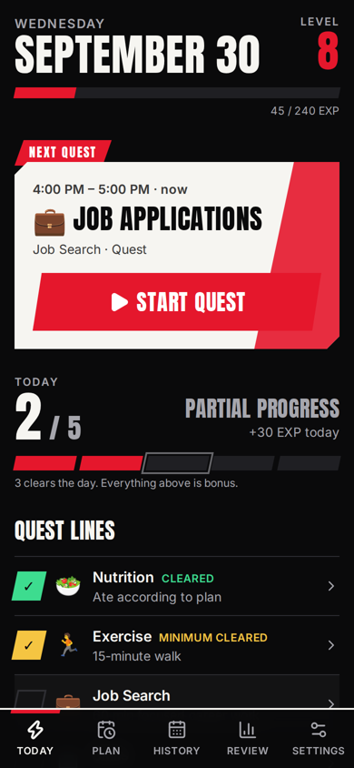
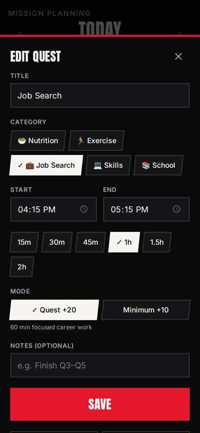
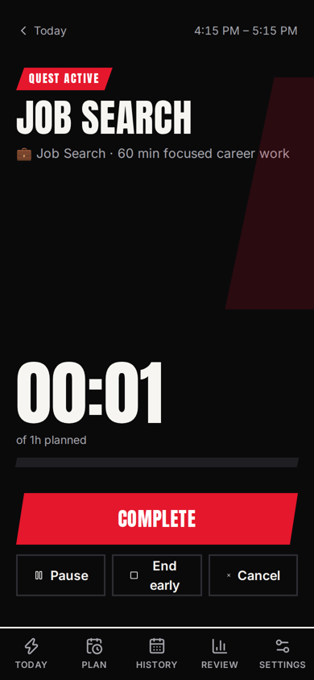
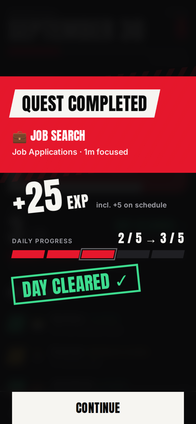
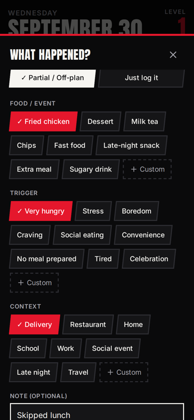
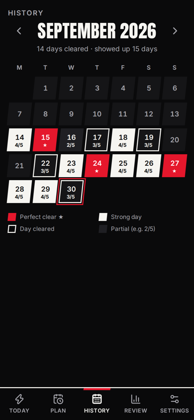
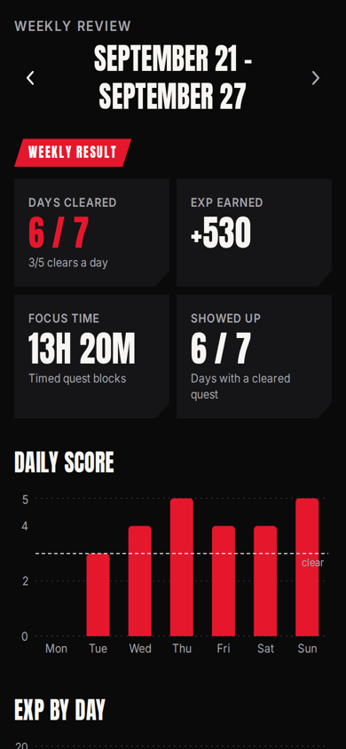
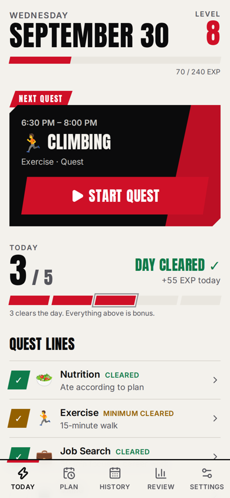

# Quest

A mobile-first personal productivity RPG. Quest turns slow-feedback goals — healthy eating, exercise, job searching, studying, skill building — into short daily quests with immediate feedback.

```
Choose Quest → Start Quest → Focus → Complete → Receive Feedback → Continue
```

You only need to clear the next quest.

---

## Behavioral philosophy

| Principle | How the app applies it |
|---|---|
| **Evaluate behaviors daily. Evaluate outcomes weekly.** | Today scores what you *did*. The Weekly Review is where outcomes (applications → responses, weight trend) are compared against behavior. |
| **Reduce scope, don't abandon the system.** | Every quest line has a **Minimum Quest**. It still clears the category and still earns EXP. |
| **3 / 5 is success.** | With five quest lines, 3 clears the day (`DAY CLEARED ✓`), 4 is a strong day, 5 is a bonus `PERFECT CLEAR`. Thresholds scale if you change the number of active lines. |
| **No punishment.** | EXP is never deducted (enforced by a DB check constraint). No streaks to break. After a gap, the next clear says `Welcome back.` |
| **Capture the pattern, not a diary.** | "What happened?" logs are tap-to-select chips (food / trigger / context, or a reason) that take ~20 seconds and aggregate into *observed patterns* — never framed as causes. |

## Screenshots

Demo data, iPhone viewport (390×844). Replace with your own as the app evolves.

| Today | Plan | Active quest | Quest completed |
|---|---|---|---|
|  |  |  |  |

| What happened? | History | Weekly review | Light theme |
|---|---|---|---|
|  |  |  |  |

## Features (MVP)

- **Today** — date, level + EXP bar, daily score with pips, **Next Quest** card, quest-line status list. Tap a quest line to log a Quest / Minimum Quest or "What happened?".
- **Plan** — tap a category chip to drop a block into the next free slot, adjust times with duration presets, copy the previous day's plan, day note. Works for any day (plan tomorrow tonight).
- **Active Quest** — focus screen with timer (persisted in the DB, survives refresh/app close), Pause / Resume / Complete / End early / Cancel.
- **Quest Completed** — ~1s animated result: EXP, daily progress `2 / 5 → 3 / 5`, `DAY CLEARED ✓` / `PERFECT CLEAR ★`, level-up, welcome-back.
- **EXP & levels** — +20 Quest, +10 Minimum, +5 on-schedule bonus; upgrading Minimum → Normal pays the difference. Level curve 100, 120, 140 … (configurable).
- **Deviation log** — nutrition (food / trigger / context + "Partial / Off-plan") and reason-based logs for other lines; custom tags inline.
- **History** — month calendar with tiered day markers (shape + text, not color alone); tap a day for its full summary.
- **Weekly Review** — clears, EXP, focus time, daily-score and EXP charts, behavior grid, Normal vs Minimum, job-search behavior vs outcomes, weight 7-day average vs last week, nutrition patterns + observed combinations, 2-question reflection.
- **Settings** — quest lines (name, icon, description, targets, EXP, default length, log style, active, order), level curve, bonus, week start, theme (dark / light), reduced motion, weight unit, tag management, JSON export.
- **PWA** — manifest, icons, standalone display, safe-area aware layout, service worker that caches the app shell (never your data).

## Tech stack

- React 19 + TypeScript (strict), Vite 8
- Tailwind CSS v4
- Supabase (Postgres + Auth magic link + Row Level Security)
- Recharts (lazy-loaded on the Review screen), lucide-react icons
- Self-hosted fonts via Fontsource (Anton display, Inter body)
- Vitest (unit tests + RLS tests against the real migration using PGlite), oxlint

## Architecture

```
UI (screens/, components/)
   │  hooks: useQuery / useAction / useDay  (refetch on a global version counter)
   ▼
state/AppContext        auth, settings, categories, tags, total EXP, result overlay
   ▼
data/questService.ts    business operations: record/complete/start/pause/log/copy …
   ▼
data/repository.ts      QuestRepository interface
   ├── SupabaseRepository   (when VITE_SUPABASE_* is set and you're signed in)
   └── LocalRepository      (Local Mode: one JSON document in browser storage)

lib/  pure logic — levels, scoring, xp, aggregation, dates, blocks (unit-tested)
```

- **Business logic is UI-free.** `lib/` is pure functions; `data/questService.ts` orchestrates them over the repository.
- **Level formula** lives only in `src/lib/levels.ts`. Score thresholds only in `src/lib/scoring.ts`.
- **IDs are client-generated UUIDs**, so every write is an idempotent upsert on both backends.
- **Local Mode** lets you run and try the app with zero setup. Data stays in that browser only.

## Folder structure

```
quest/
├── public/                 manifest, service worker, icons
├── scripts/render-icons.mjs  regenerates PNG icons from public/icons/icon.svg
├── src/
│   ├── components/         AppShell, sheets, overlay, charts, UI primitives
│   ├── data/               repository interface + Supabase/Local implementations, questService
│   ├── hooks/              useQuery, useAction, useDay, useClock
│   ├── lib/                levels, scoring, xp, aggregate, dates, blocks, defaults (+ *.test.ts)
│   ├── screens/            Today, Plan, Quest, History, Review, Settings, Login
│   ├── state/AppContext.tsx
│   └── types.ts
├── supabase/
│   ├── migrations/         SQL schema + RLS
│   └── tests/rls.test.ts   applies the migration to embedded Postgres and checks RLS
└── .env.example
```

## Local installation

Requires Node 20+.

```bash
npm install
cp .env.example .env      # optional — leave empty for Local Mode
npm run dev               # http://localhost:5173
```

Without Supabase variables the app starts in **Local Mode** (Settings shows which mode you're in).

## Environment setup

| Variable | Where to find it |
|---|---|
| `VITE_SUPABASE_URL` | Supabase → Project Settings → API → Project URL |
| `VITE_SUPABASE_ANON_KEY` | Supabase → Project Settings → API → `anon` / publishable key |

**Only the public anon key goes in the client.** The app refuses to start if the key looks like a `service_role` / `sb_secret_` key. `.env` is git-ignored.

## Supabase setup

1. Create a project at [supabase.com](https://supabase.com).
2. Apply the schema — either:
   - **SQL editor:** paste `supabase/migrations/20260930000000_init.sql` and run it, or
   - **CLI:** `npx supabase link --project-ref <ref>` then `npx supabase db push`.
3. **Auth → Providers → Email:** enabled (magic link is the default).
4. **Auth → URL Configuration:** set *Site URL* to your deployed URL and add `http://localhost:5173` to *Redirect URLs* for development.
5. Optional but recommended for a personal app: **Auth → Providers → Email → disable "Allow new users to sign up"** after you've signed in once, so nobody else can create an account.
6. Put the URL and anon key in `.env` (locally) and in your host's environment variables (production).

On first sign-in the app seeds the five default quest lines and default tags for your user.

## Database schema

| Table | Purpose | Key constraints |
|---|---|---|
| `user_settings` | week start, level curve, bonus, theme, motion, weight unit | PK `user_id` |
| `categories` | quest lines (name, icon, targets, EXP, default minutes, log style, active, order) | |
| `daily_plans` | one row per day — the day note | unique `(user_id, date)` |
| `time_blocks` | planned quests + timer state (`started_at`, `paused_at`, `paused_seconds`) | status/mode checks |
| `daily_completions` | per-day, per-category result: `normal` / `minimum` / `partial` / `incomplete` | unique `(user_id, date, category_id)` |
| `xp_events` | EXP ledger | `amount >= 0` |
| `user_xp_totals` | view: total EXP per user | `security_invoker` so RLS applies |
| `deviation_logs` | "What happened?" — `item_label`, `trigger` (or reason), `context`, `note` | |
| `tags` | reusable quick-select chips by kind (`food`, `trigger`, `context`, `reason`) | |
| `weekly_reviews` | what worked / one adjustment | unique `(user_id, week_start)` |
| `outcome_metrics` | weight, waist, applications, responses, interviews … | unique `(user_id, date, metric_type)` |

Every table has `user_id default auth.uid()` and four owner-only RLS policies (select / insert / update / delete). Triggers additionally reject references to another user's category. `anon` has no table access.

### Migrations

New schema changes go in a new file in `supabase/migrations/` named `YYYYMMDDHHMMSS_description.sql`. `npm test` applies all migrations in order to an embedded Postgres and runs the RLS tests, so a broken migration fails CI.

## Development commands

| Command | What it does |
|---|---|
| `npm run dev` | Vite dev server |
| `npm run lint` | oxlint (warnings fail) |
| `npm run typecheck` | `tsc -b` |
| `npm test` | Vitest: logic, service, and RLS tests |
| `npm run build` | type-check + production build to `dist/` |
| `npm run check` | all of the above |
| `npm run preview` | serve the production build locally |

## Production build & deployment

`npm run build` outputs a static site in `dist/`. Any static host works; it needs a SPA fallback (all paths → `index.html`).

**Vercel** (config included: `vercel.json`)
1. Import the private GitHub repo.
2. Framework preset: Vite. Build `npm run build`, output `dist`.
3. Add `VITE_SUPABASE_URL` and `VITE_SUPABASE_ANON_KEY` as environment variables.
4. Add the Vercel URL to Supabase Auth → Site URL / Redirect URLs.

**Netlify** (config included: `public/_redirects`) — same steps; build `npm run build`, publish `dist`.

HTTPS is required for the service worker and for "Add to Home Screen" to behave as a standalone app.

## Install on iPhone (PWA)

1. Open your deployed Quest URL in **Safari**.
2. Tap **Share** → **Add to Home Screen** → **Add**.
3. Launch Quest from the Home Screen — it opens full-screen without Safari's toolbar.
4. Sign in. iOS gives Home Screen apps their own storage, separate from Safari, so a magic link tapped in Mail signs in *Safari*, not the installed app. Inside the installed app, enter the **code** from the email instead. To include the code, edit **Supabase → Auth → Email Templates → Magic Link** and add `{{ .Token }}` to the template (e.g. `Your code: {{ .Token }}`).

Offline: the app shell loads offline; data requires a connection in Supabase mode (Local Mode works fully offline).

## Security & privacy

- Row Level Security on every table; tested in `supabase/tests/rls.test.ts`.
- No service-role key anywhere in the client; runtime guard rejects one.
- The service worker never caches cross-origin (API) responses.
- Personal records live only in the database (or your browser in Local Mode) — never in the repo. `.env`, exports (`quest-export-*.json`) and Supabase local state are git-ignored.
- Settings → Export gives you a JSON copy of all your data.

## Not in the MVP (by design)

Social features, leaderboards, AI coach, avatars, shops, achievement trees, notifications.

## Known limitations / next steps

- Supabase export reads up to 1,000 rows per table (PostgREST default); paginate if you accumulate more.
- No offline write queue in Supabase mode.
- The weekly job-search outcomes are entered manually.
